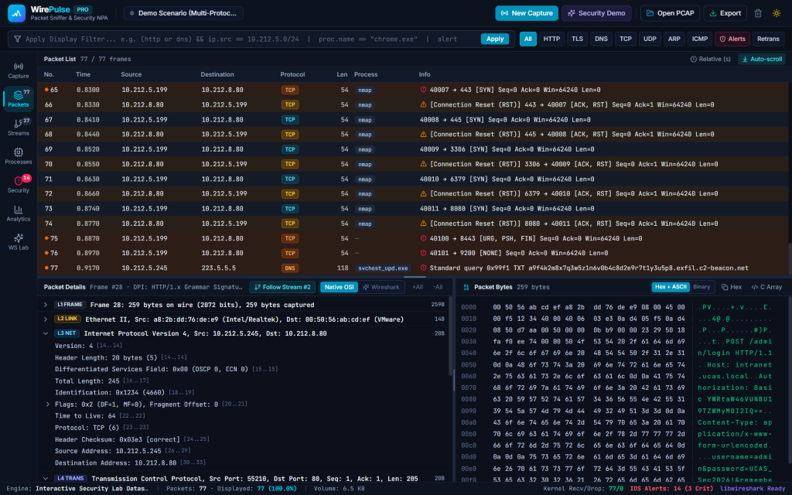
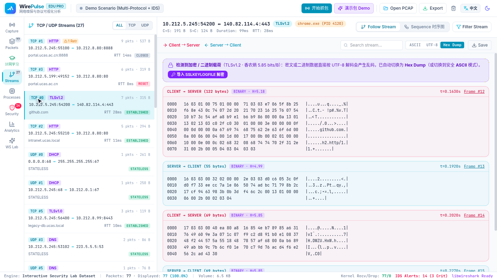
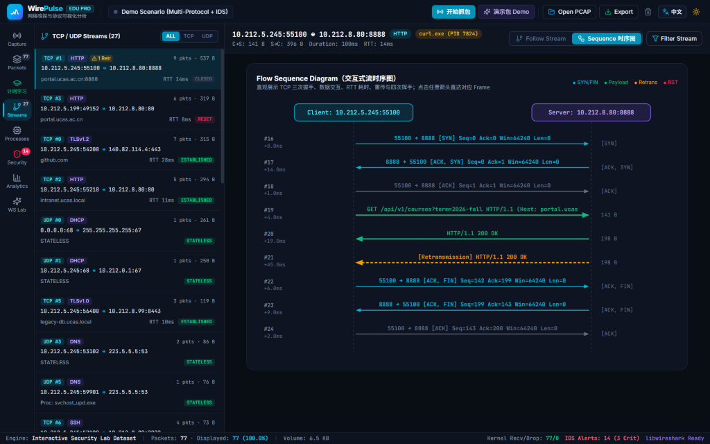
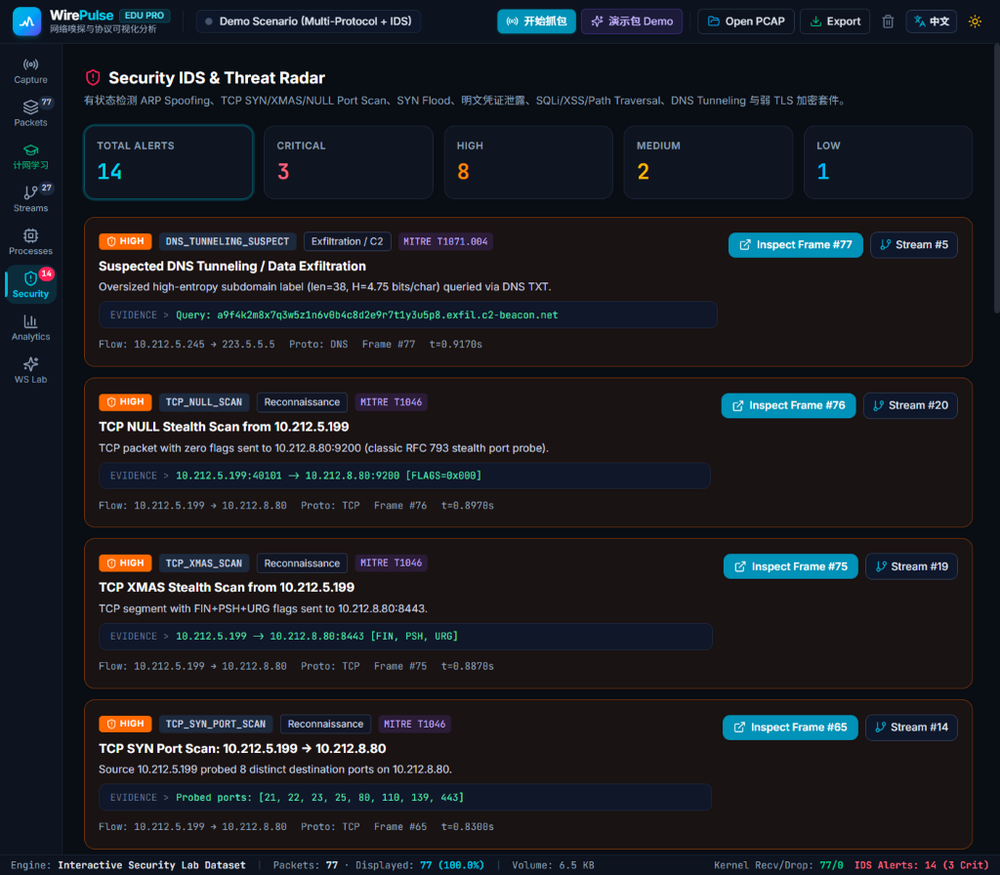
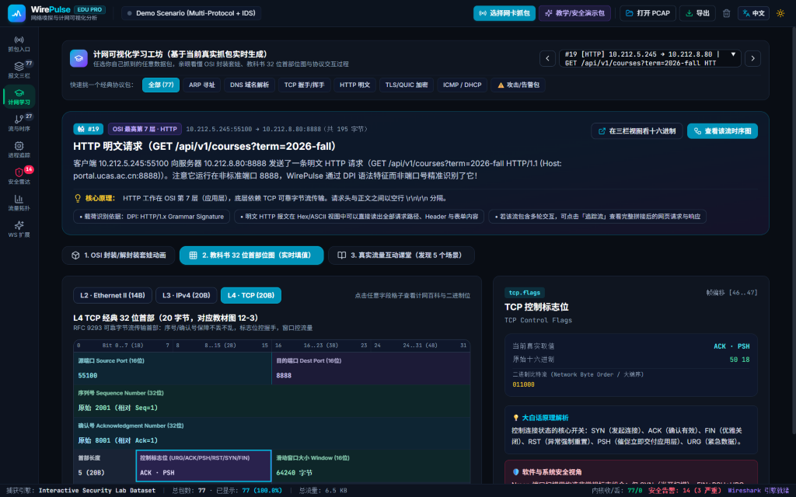
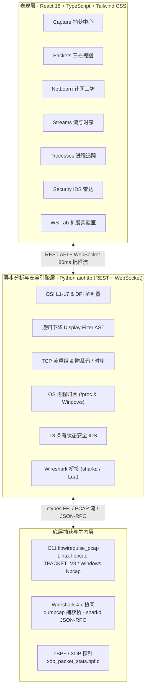

<div align="center">

# WirePulse

**下一代跨平台网络嗅探器、实时安全协议分析仪与计网可视化学习工坊**

[](#核心特性)
[%20Dual--Engine-7c3aed?style=flat-square)](#wireshark-增量扩展)
[](#界面预览)
[](#内置安全-ids-检测规则)
[](#关于项目)

*融合原生 C11 底层嗅探、自研 OSI 七层 DPI 解析与逻辑过滤、Wireshark 生态双引擎协同、OS 进程流量归因、13 条有状态安全 IDS 雷达以及面向本科《计算机网络》初学者的实包可视化教学工坊。*

</div>

---

## 界面预览

### 1. 经典 Wireshark 三栏浏览 & 双向字节高亮
支持虚拟滚动浏览、Wireshark 语义着色规则、非标端口 DPI 识别、一键切换 `Native OSI` ↔ `Wireshark (sharkd)` 双引擎，以及内嵌协议字段百科卡。



### 2. Follow Stream 防乱码重组 & 交互式 SVG 流时序图
- **TCP 序列号重组与重传去重**：按五元组还原双色对话；对 `TLS` / `QUIC` / `SSH` 等高熵加密或二进制流自动切换为经典 16-Byte **Hex Dump**（零 `U+FFFD` 乱码与控制字符方块），支持一键导入 `SSLKEYLOGFILE` 解密。
- **交互式流时序图**：直观呈现 TCP 三次握手、RTT 延迟、橙色虚线重传与四次挥手，点击任意箭头直达三栏对应 Frame。

<table>
  <tr>
    <td></td>
    <td></td>
  </tr>
</table>

### 3. 实时安全 IDS 雷达 & 计网可视化学习工坊（NetLearn Studio）
- **13 条有状态安全 IDS**：覆盖 `CRITICAL` / `HIGH` / `MEDIUM` / `LOW` 四级告警、MITRE ATT&CK 编号、原始取证证据及一键跳帧。
- **NetLearn 学习工坊**：基于用户真实抓包实时生成 **OSI 封装/解封装套娃动画**、**教科书 RFC 32-bit 首部位图（实时填值 + 二进制比特流 + 考点与安全视角）** 与 **TCP 状态机互动课堂**。

<table>
  <tr>
    <td></td>
    <td></td>
  </tr>
</table>

---

## 核心特性

- **原生 C11 跨平台捕获引擎（NPS）**
  - 零系统头文件依赖编译 `libwirepulse_pcap.so/.dll`，动态加载 Linux `libpcap`（启用 `AF_PACKET TPACKET_V3` 环形缓冲区）或 Windows Npcap `wpcap.dll`；Windows 环境支持无编译器 `ctypes` 直连开箱即用。
  - 支持网卡列表实时流量 Sparkline、混杂模式、Snaplen、可调内核 Ring Buffer、内核态 BPF 编译校验（`pcap_compile`）、标准 `.pcap` / `.pcapng` 导入导出，并配套提供 Linux eBPF/XDP 驱动层统计探针（`core/ebpf/xdp_packet_stats.bpf.c`）。
- **深度协议解剖与无端口依赖 DPI（NPA）**
  - 自研 L1–L7 解析器覆盖 Ethernet II、ARP、IPv4/IPv6、ICMP/ICMPv6、TCP/UDP、DNS/mDNS、DHCP、HTTP/1.x、HTTP/2、TLS 1.0–1.3（含 SNI、ALPN、JA3/JA3S 指纹）、QUIC、SSH、FTP、WebSocket 等 20+ 协议。
  - 优先基于载荷魔数与语法特征识别应用层（如非标端口 `8888` 上的 HTTP、`2222` 上的 SSH），透明标注 `dpi.method` 识别依据。
- **手写递归下降 Display Filter 编译器 & 可视化向导**
  - 自主实现词法分析器 + 递归下降 AST 求值引擎，兼容 Wireshark 过滤语法（`&&`/`||`/`!`、括号优先级、`==`/`!=`/`>`/`<`、`contains`、`matches` 正则、`in {...}` 集合、CIDR 网段匹配、进程与告警过滤），提供实时语法树提示与新手点选式 Filter 向导。
- **Wireshark 增量扩展**
  - 协议细节栏一键切换 **Native OSI** ↔ **Wireshark `libwireshark (sharkd)`** 双引擎，直接复用 Wireshark 3,000+ 工业级协议解析能力。
  - 内置 `SSLKEYLOGFILE` 密钥日志管理（联动 `sharkd` 解密 HTTPS/TLS 1.2 & 1.3）、Wireshark 兼容着色规则及 **自定义 Wireshark `.lua` Dissector 插件可视化生成器**。
- **OS 操作系统进程级流追踪（对标 CommView）**
  - 通过 Linux `/proc/net/*` Socket Inode 与 Windows 连接表将 TCP/UDP 五元组实时映射至宿主机进程 PID，一键追踪指定进程产生的全部通信流与数据包。
- **双语 & 双主题体验**
  - 支持 **`中文`（Wireshark 原味中英混排）** 与 **`EN`（100% 纯英文）** 一键切换；默认清爽 **Daylight 白色主题**，支持随时切换 **Obsidian 深色主题**。

---

## 系统架构



---

## 内置安全 IDS 检测规则

| 等级 | 规则代号 | 类别 | 检测原理 |
|---|---|---|---|
| `CRITICAL` | `ARP_SPOOFING` | Network MITM | 有状态维护局域网 `IP → MAC` 绑定表，捕捉同一 IP 突现冲突 MAC 的 ARP 欺骗 |
| `CRITICAL` | `HTTP_SQL_INJECTION` | Web Attack | URL 规范化解码后检测 `UNION SELECT`、永真注入、`DROP TABLE` 等 SQLi 载荷 |
| `CRITICAL` | `CLEARTEXT_HTTP_BASIC_AUTH` | Credential Exposure | 识别明文 HTTP `Authorization: Basic` 头并自动 Base64 解码取证 |
| `CRITICAL` | `TCP_SYN_FLOOD` | Denial of Service | 2 秒滑动时间窗统计单目标高频 SYN 洪峰 |
| `HIGH` | `TCP_SYN_PORT_SCAN` / `XMAS` / `NULL` | Reconnaissance | 检测单源跨多端口 SYN 扫描、以及 `FIN+PSH+URG` / 全零标志隐蔽探针 |
| `HIGH` | `HTTP_XSS_PAYLOAD` / `HTTP_PATH_TRAVERSAL` | Web Attack | 解码检测 `<script>`/`onerror=` 跨站脚本与 `../../etc/passwd` 路径遍历 |
| `HIGH` | `CLEARTEXT_CREDENTIAL_LEAK` / `BEARER_JWT` / `FTP PASS` | Credential Exposure | 识别未加密传输的表单密码、Bearer JWT 令牌与 FTP 明文口令 |
| `HIGH` | `DNS_TUNNELING_SUSPECT` | Exfiltration / C2 | 结合子域名长度与**香农熵（Shannon Entropy）**识别异常数据外传隧道 |
| `MEDIUM` | `TLS_DEPRECATED_VERSION` / `DNS_NXDOMAIN_BURST` | Crypto / C2 | 审计已废弃的 SSL 3.0 / TLS 1.0 / TLS 1.1 及高频 NXDOMAIN（疑似 DGA） |
| `LOW` | `TCP_ZERO_WINDOW` / `TLS_WEAK_CIPHER` | Transport / Crypto | 提示接收窗口归零阻塞（Zero Window）及非 PFS/AEAD 弱加密套件 |

---

## 快速开始

### Linux / WSL2

```bash
git clone https://github.com/Seegin/WirePulse.git
cd WirePulse

# 1. 编译 C11 原生捕获动态库（零外部头文件依赖）
bash core/build.sh

# 2. 安装 Python 依赖
pip install -r requirements.txt

# 3. 启动服务（已内置预构建前端 frontend/dist，无需安装 Node）
python3 wirepulse.py             # 正常启动并打开界面 (http://127.0.0.1:8765)
python3 wirepulse.py --demo      # 启动并预载全协议 + 安全 IDS 教学演示包
```

### Windows

1. 安装 [Npcap](https://npcap.com/)（可选安装 [Wireshark](https://www.wireshark.org/) 以启用 `sharkd` 双引擎与 `dumpcap` 捕获桥）。
2. 安装 Python 依赖 `pip install -r requirements.txt`。
3. 双击 `start_windows.bat` 或运行 `python wirepulse.py` 即可自动弹出桌面应用窗口。

### 运行自动化测试套件

```bash
python3 tests/test_backend.py
```

测试覆盖 C11 `libpcap` 与 BPF 校验、OSI 多协议与非标端口 DPI、Display Filter AST、TCP 重传去重与 TLS 防乱码、OS 进程归因、13 条 IDS 规则、Wireshark `sharkd` 双引擎、Lua 生成及 PCAP 往返导出导入（8 / 8 全部通过）。

---

## 目录结构

```text
WirePulse/
├── wirepulse.py                 # 跨平台一键启动器（自动打开桌面 App 窗口）
├── start_windows.bat            # Windows 一键启动脚本
├── start_linux.sh               # Linux 一键启动脚本
├── core/                        # C11 原生 libpcap/Npcap 捕获引擎 & eBPF/XDP 探针
│   ├── capture_engine.{h,c}
│   ├── pcap_abi.h
│   └── ebpf/xdp_packet_stats.bpf.c
├── backend/                     # Python aiohttp 异步协议剖析与安全引擎
│   ├── dissector/               # OSI L1-L7 解析、DPI、DNS、TLS JA3、OUI 厂商库
│   ├── filter_engine.py         # 递归下降 Display Filter 编译器与求值器
│   ├── stream_engine.py         # TCP/UDP 流重组、防乱码熵检测与 SVG 时序数据
│   ├── process_tracker.py       # 跨平台 OS 进程 PID 流量归因
│   ├── security_engine.py       # 13 条有状态安全 IDS 规则引擎
│   ├── wireshark_bridge.py      # Wireshark sharkd / dumpcap / Keylog / Lua 桥接
│   └── direct_pcap.py           # Windows Npcap wpcap.dll 零编译直连引擎
├── frontend/                    # React 18 + TypeScript + Tailwind v4 前端源码与 dist 产物
├── samples/                     # 内置多协议与安全攻防演示捕获包 (.pcap)
├── tests/                       # 端到端自动化单元测试套件
└── docs/                        # 完整实验报告 (Markdown / PDF / DOCX) 与实机截图
```

---

## 关于项目

- **作者**：梁献中（`202628015059042`）
- **课程**：中国科学院大学（UCAS）《软件与系统安全》实验 1A — 带 GUI 的网络嗅探器设计与实现
- **详细技术报告**：见 [`docs/report.md`](docs/report.md) 与 [`docs/WirePulse_实验1A报告.pdf`](docs/WirePulse_实验1A报告.pdf)
