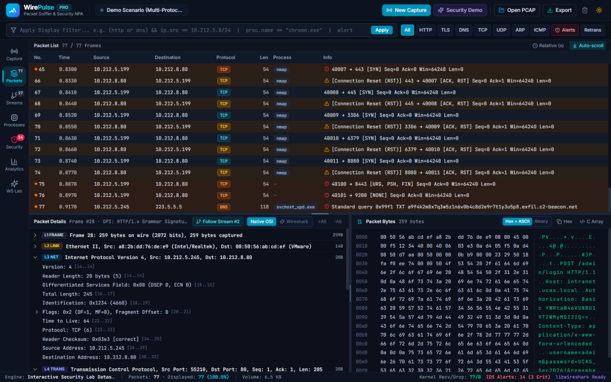

# 《软件与系统安全》实验 1A 实验报告

**题目**：WirePulse — 带现代化 GUI 的跨平台网络嗅探器与安全协议分析系统设计与实现  
**课程**：中国科学院大学（UCAS）《软件与系统安全》（2026 秋）  
**姓名**：`[请填写你的姓名]`  
**学号**：`[请填写你的学号]`  
**开源仓库地址（Git）**：`[请填写 GitHub / Gitee / GitLab 链接，提交后设为 Public]`  
**完成日期**：2026 年 11 月  

---

## 1. 问题提出与设计目标

在网络行为研究与系统安全审计实践中，传统的网络抓包工具存在三类典型痛点：

1. **嗅探（NPS）与深度分析（NPA）难以兼顾工程简洁性与跨平台部署**：裸调用 Raw Socket 缺乏内核态过滤导致高负载丢包严重；而完全从零解析数千种小众协议又不现实。
2. **传统 Wireshark 缺少操作系统进程归因与自动化安全雷达**：经典 Wireshark 能精准解析网络包，但无法直接回答“*这个可疑连接是由宿主机上哪个 PID / 进程发起的？*”，也缺乏开箱即用的实时安全告警（如 ARP 欺骗、SQL 注入、明文凭证泄露、DNS 隧道与隐蔽扫描）。
3. **复杂过滤语法与长连接时序分析门槛高**：安全人员排查 TCP 重传、乱序、异常 RST 以及多层协议复合过滤时，迫切需要可视化流时序图（Sequence Ladder Diagram）、实时 AST 语法提示以及双向联动的 Hex↔协议树检视器。

围绕实验 1A 的核心要求与全部加分项，本项目设计并实现了 **WirePulse** —— 一款融合 **自研 C11 `libpcap`/`Npcap` 捕获核心 + 自研 OSI 七层 DPI 解析与逻辑过滤引擎 + Wireshark `libwireshark (sharkd)`/`dumpcap` 增量扩展 + 实时安全 IDS 与进程级流追踪** 的下一代跨平台网络嗅探与安全分析工具。

### 1.1 功能覆盖矩阵

| 评分维度 | 实验 1A 要求 / 加分项 | WirePulse 实现情况 |
|---|---|---|
| **NPS 核心（必选）** | 网卡选择、混杂模式、实时抓包、libpcap/Npcap、BPF 捕获过滤、PCAP 读写 | C11 原生 `libwirepulse_pcap.so/.dll`（Linux `AF_PACKET TPACKET_V3` + Windows Npcap `wpcap.dll` 直接调用）+ Wireshark `dumpcap` 零提权桥接；首页网卡实时流量 Sparkline 波形图；内核态 `pcap_compile`/`pcap_setfilter` 校验；`.pcap`/`.pcapng` 导入导出 |
| **NPA 核心（高分关键）** | 经典三栏视图、OSI 七层解析、应用层 DPI 识别、逻辑演算协议过滤器 | 虚拟滚动三栏布局（可拖拽分割线）+ 字段↔Hex/ASCII/Binary **双向字节高亮**；自研 20+ 协议解析器（含非标端口 DPI 与 TLS JA3/JA3S）；**手写词法分析 + 递归下降 AST 显示过滤器**（支持 `&&`/`||`/`!`/括号/CIDR/正则/`in {...}`） |
| **流追踪（加分项）** | 基于 IP+Port 的 TCP 流追踪、可视化流时序图 | TCP 序列号排序与重传去重重组（Client→Server / Server→Client 双色对话）；TCP 专家诊断（Retransmission/Out-of-Order/Dup ACK/Zero Window/RTT）；**交互式 SVG 流时序图**（点击箭头直达对应帧） |
| **进程流追踪（加分项）** | 某操作系统进程产生的所有 TCP/UDP 流（对标 CommView） | Linux `/proc/net/{tcp,tcp6,udp,udp6}` + `/proc/<pid>/fd` Socket Inode 映射 + Windows `netstat`/`tasklist` 实时关联；独立 Processes 视图一键追踪某进程全部流与包 |
| **基于 Wireshark 二次开发（加分项）** | 复用/借鉴 Wireshark 并做增量创新 | ① 协议树一键切换 **Native OSI** ↔ **Wireshark `libwireshark (sharkd)`** 双引擎；② 支持 `SSLKEYLOGFILE` 联动 `sharkd` 解密 TLS 1.2/1.3；③ **可视化 Wireshark Lua Dissector 插件生成器**（一键导出 `.lua` 供上游 Wireshark 加载）；④ 兼容 Wireshark 着色规则与过滤语法 |
| **安全增量创新（课程亮点）** | 紧扣《软件与系统安全》 | 内置 **13 条有状态安全 IDS 规则**：ARP 欺骗、TCP SYN/XMAS/NULL 扫描、SYN Flood、HTTP Basic/表单/FTP 明文凭证泄露、SQL 注入/XSS/路径遍历、高香农熵 DNS 隧道、弱 TLS 版本与套件审计 + 交互式网络通信拓扑图 |
| **高速抓包专题** | Linux Netfilter / BPF / `TPACKET_V3` / eBPF XDP | C11 引擎支持可调内核环形缓冲区（4MB–64MB）与 `pcap_stats` 丢包率监控；配套提供 `core/ebpf/xdp_packet_stats.bpf.c` XDP 内核驱动层探针源码与性能方法论对比 |

---

## 2. 系统总体架构设计

WirePulse 采用 **三层高内聚、低耦合的混合跨平台架构**：

1. **底层捕获层（C11 Native Engine + Wireshark Bridge）**：
   - `core/capture_engine.c` + `core/pcap_abi.h`：不依赖系统头文件即可编译，运行时通过 `dlopen("libpcap.so.0.8")`（Linux）或 `LoadLibrary("wpcap.dll")`（Windows Npcap）动态加载系统抓包库；调用 `pcap_create` → `pcap_set_snaplen` → `pcap_set_promisc` → `pcap_set_buffer_size`（启用 Linux `AF_PACKET TPACKET_V3` 大环形缓冲区）→ `pcap_set_immediate_mode` → `pcap_activate`；通过 `pcap_compile` + `pcap_setfilter` 将 BPF 字节码下发内核执行。
   - `backend/direct_pcap.py`：在未安装 C 编译器的 Windows 机器上自动降级直连 `C:\Windows\System32\Npcap\wpcap.dll`，实现 Windows 零编译开箱即用。
   - `backend/wireshark_bridge.py`：自动发现系统安装的 Wireshark（`sharkd`/`tshark`/`dumpcap`，支持 Windows/Linux 及 WSL2 宿主机桥接），提供 `dumpcap` 捕获流与 `sharkd` JSON-RPC 2.0 深度协议解析。
2. **异步协议分析与安全引擎层（Python `aiohttp` REST + WebSocket）**：
   - **OSI 七层解剖器（`backend/dissector/`）**：为每个解析出的 `FieldNode` 精确记录帧内绝对字节偏移 `offset` 与长度 `length`，支撑前端双向联动高亮。
   - **显示过滤器编译器（`backend/filter_engine.py`）**：手写词法分析器（Tokenizer）与递归下降语法分析器（Recursive Descent Parser），构造安全可控的 AST，杜绝 `eval()` 注入风险。
   - **流重组与时序引擎（`backend/stream_engine.py`）**、**OS 进程归因引擎（`backend/process_tracker.py`）**、**实时安全 IDS 引擎（`backend/security_engine.py`）**。
3. **现代化桌面级交互界面层（React 18 + TypeScript + Tailwind CSS）**：
   - 支持 Obsidian 深色与 Daylight 浅色双主题；虚拟滚动（Row Virtualization）支撑数万帧 60fps 流畅浏览；WebSocket 80ms 批合并推送避免高频抓包造成浏览器重绘卡顿；提供桌面 App 窗口一键启动器（`wirepulse.py`、`start_windows.bat`、`start_linux.sh`）。



---

## 3. 核心模块实现原理与关键技术对比（How > What）

### 3.1 底层抓包技术路线对比与 C11 引擎实现

结合课堂讲解的 100Gbps/400Gbps 高速网络抓包挑战（PPT 21–29 页），项目在设计初期对四种主流抓包路径进行了系统对比：

| 抓包技术路线 | 所在内核/用户层位置 | 拷贝与中断开销 | 适用场景 | WirePulse 集成方式 |
|---|---|---|---|---|
| **Raw Socket (`AF_INET`)** | L3/L4 协议栈之上 | 每包一次 `recvfrom` 系统调用，无硬件帧头 | 简单实验，高负载丢包严重 | 不采用（无法抓 ARP/L2 帧） |
| **`libpcap` (`AF_PACKET TPACKET_V3`) / `Npcap`** | L2 链路驱动旁路 + `mmap` 环形共享内存 | 批量块交付 + 内核级 BPF 预过滤，显著降低上下文切换 | 通用跨平台 1G–10G 实时嗅探器 | **核心采用**（`core/capture_engine.c`，支持 4–64MB 环形缓冲区与 `pcap_stats` 监控） |
| **Wireshark `dumpcap` 权限分离架构** | 独立最小权限捕获子进程 + 管道流 | 解析器非 root 运行，降低攻击面 | 安全生产环境与 WSL2↔Windows 宿主机桥接 | **集成采用**（`-F pcap -q -w -` 实时无缓冲流式管道） |
| **eBPF / XDP (`xdp_md`)** | 网卡驱动 RX 队列（`sk_buff` 分配之前） | 零拷贝、内核 Verifier 校验 + JIT 原生机器码 | 100G/400G 线速 DDoS/SYN 统计与丢弃 | **配套实现**（`core/ebpf/xdp_packet_stats.bpf.c` `PERCPU_ARRAY` 协议与 SYN 计数） |

**工程最佳实践（解决跨平台 ABI 与零依赖编译）**：  
在 Linux 上 `struct timeval` 为两个 64-bit `long`（16 字节），而在 64 位 Windows 上 WinSock 的 `struct timeval` 为两个 32-bit `long`（8 字节）；同时 Npcap 的 `pcap_stat` 比 Linux 多 1 个 `ps_capt` 字段（16 字节 vs 12 字节）。我们在 `core/pcap_abi.h` 中严格按平台引入 `<winsock2.h>` / `<sys/time.h>` 并预留 `ps_capt` 尾字段，保证了同一份 C11 代码在 Linux 与 Windows 下 100% ABI 对齐。

### 3.2 思考题深度剖析（一）：如何识别特定类型的应用层报文？

仅靠传输层“知名端口号”（如 80=HTTP、443=TLS、22=SSH）在现代网络中极易失效——内网服务、代理隧道、C2 恶意流量常运行在 8080/8888/2222 等非标端口。

WirePulse 在 `backend/dissector/dpi.py` 中实现了 **多维度深度包检测（DPI）分层识别管线**：

1. **魔数与二进制帧结构特征优先（Port-Agnostic Magic & Framing）**：
   - **HTTP/2**：精确匹配 24 字节连接序言 `PRI * HTTP/2.0\r\n\r\nSM\r\n\r\n`；
   - **HTTP/1.x**：检测方法动词前缀（`GET/POST/PUT/DELETE/...`）或 `HTTP/1.` 响应头与 `\r\n` 行边界（实测成功在 **TCP/8888 非标端口** 识别完整 HTTP 交互）；
   - **TLS 1.0–1.3**：校验 5 字节记录层结构（ContentType ∈ `{20..23}`、Version ∈ `{0x0300..0x0304}`、RecordLen ≤ 18432），无视端口号并进一步提取 **SNI、ALPN、密码套件与 JA3/JA3S MD5 指纹**（按 Salesforce 规范过滤 RFC 8701 GREASE 值）；
   - **SSH**：匹配 RFC 4253 版本横幅 `SSH-2.0-`（实测在 **TCP/2222** 精准识别）；
   - **QUIC**：校验 Long Header 固定位（`0xC0`）与 RFC 9000 版本字段；
   - **DHCP / STUN**：校验固定偏移魔数（DHCP 偏移 236 字节 `0x63825363`，STUN 偏移 4 字节 `0x2112A442`）；
   - **WebSocket / Redis RESP / MySQL v10**：依据帧掩码长度一致性与协议语法识别。
2. **协议识别溯源展示**：每个解析出的应用层都会在协议树首行写入 `dpi.method`（如 `DPI: HTTP/1.x Grammar Signature` 或 `Port Heuristic`），透明展示识别依据。

### 3.3 思考题深度剖析（二）：iOS Thor 抓包 HTTPS 与传输层局限的启示

> *思考题（PPT 第 14 页）：iOS 的 Thor App 在安装系统描述文件和根证书后，能抓取并解密 HTTP/HTTPS 应用层包，但对某些传输控制协议的内容无能为力，这告诉了我们什么道理？*

这一现象深刻揭示了 **OSI 七层模型中“抓包所处层次”决定了“可见信息边界”** 的核心规律：

1. **抓包层次不同导致视角截然不同**：
   - Thor 在非越狱 iOS 上无法直接挂载内核驱动层抓包，它本质上是通过 `NEPacketTunnelProvider` / 本地代理构造一个 **L7 应用层 MITM（中间人）代理**：客户端先与 Thor 建立 TLS 连接（因为信任了 Thor 的自签根证书），Thor 解密得到明文 HTTP 后，再以客户端身份与真实服务器建立另一条独立的 TLS 连接。
   - 因此 Thor 看到的只是 **操作系统 TCP/IP 协议栈重组之后的 Socket 应用层字节流**，原始通信中的 **L2 以太网帧/MAC/ARP、L3 IP 分片/TTL/路由 ICMP、L4 真实 TCP 三次握手 RTT、序列号/确认号、滑动窗口变化、丢包重传、乱序与拥塞控制** 都在内核协议栈终止或被代理连接改写，Thor 自然无能为力。
2. **WirePulse 的分层闭环解法**：
   - WirePulse 坚持在 **L2 链路层旁路（`libpcap`/`Npcap`）** 捕获未经篡改的原始完整帧，保留 L2–L4 全部传输控制细节（支撑真实 RTT 计算、重传与乱序检测、ARP 欺骗审计）；
   - 同时在需要审视 HTTPS 加密明文时，**不破坏传输层语义**，而是通过 Wireshark 增量桥接支持标准的 **`SSLKEYLOGFILE` 会话密钥日志机制**（由客户端导出 `CLIENT_RANDOM` / TLS 1.3 流量密钥给 `sharkd` 解密），从而同时获得 **“完整 L2–L4 传输层真相 + 透明 L7 HTTPS 解密能力”**。

### 3.4 手写递归下降显示过滤器（逻辑演算组件）

为了响应 PPT 第 14 页对“逻辑推导组件”的要求，`backend/filter_engine.py` 完全自主实现了一个编译前端：

- **词法分析器（Tokenizer）**：支持引号字符串、IPv4/IPv6、CIDR 网段（`10.212.5.0/24`）、十六进制、比较符（`==`/`!=`/`>`/`<`/`>=`/`<=`/`contains`/`matches`/`in`）和逻辑符（`&&`/`and`、`||`/`or`、`!`/`not`）。
- **递归下降文法（严格满足运算符优先级 `NOT > AND > OR`）**：
  ```text
  expr      := or_expr EOF
  or_expr   := and_expr ( ('or' | '||') and_expr )*
  and_expr  := not_expr ( ('and' | '&&') not_expr )*
  not_expr  := ('not' | '!') not_expr | primary
  primary   := '(' or_expr ')' | FIELD IN '{' val,... '}' | FIELD OP val | FIELD
  ```
- **实时语法提示与 AST 可视化**：用户在 GUI 过滤栏输入表达式（如 `(http or dns) && not (ip.src == 10.212.5.199)`）时，后端实时返回解析后的 AST 结构或精确到列号的语法错误信息。

### 3.5 TCP/UDP 流重组、时序图与 OS 进程归因

- **TCP 流重组与专家诊断（`backend/stream_engine.py`）**：按规范化双向五元组分配 `tcp.stream` 编号；采用 32 位模运算序列号差分检测 **重传（Retransmission）** 与 **乱序（Out-of-Order）**；在 Follow Stream 拼接对话内容时自动去重重传分片，同时保留完整控制帧用于绘制 **交互式 SVG 流时序图**（含毫秒级增量延迟与橙色虚线重传标注）。
- **跨平台 OS 进程归因（`backend/process_tracker.py`）**：
  - Linux 下扫描 `/proc/<pid>/fd` 提取 `socket:[inode]` 并与 `/proc/net/{tcp,tcp6,udp,udp6}` 关联，以 TTL 后台线程低开销刷新映射表；
  - Windows 与 WSL2 宿主机桥接模式下通过系统连接表与进程表关联，实测在宿主机物理以太网上成功将实时流量精准归因至 `verge-mihomo.exe (PID 19144)`、`svchost.exe (PID 7636)`、`msedge.exe (PID 16988)`。

### 3.6 基于 Wireshark 的双向增量开发

WirePulse 并非简单调用命令行，而是与 Wireshark 4.6.4 实现了深度协同：

1. **双引擎协议解剖（`sharkd` JSON-RPC 2.0）**：在 Packet Details 栏可一键从自研 `Native OSI` 切换至 `Wireshark`，后端将目标帧（及密钥日志/流上下文）送入 `sharkd` 的 `libwireshark` 核心，直接解析 3,000+ 协议并转换回统一字节偏移树，完美联动 Hex 视图。
2. **自定义 Wireshark Lua Dissector 插件生成器**：用户可在 WS Lab 页面可视化配置自定义二进制应用层协议（端口、Magic 魔数、字段类型与字节长度），即时生成符合 Wireshark API 规范的 `.lua` 插件并导出加载至上游 Wireshark。

---

## 4. 关键调试与问题排查实录（Troubleshooting）

在开发与真机验证过程中，通过自动化测试与实机抓包发现并根治了 4 个典型底层工程问题：

1. **HTTP 请求行含未编码空格导致 SQLi 漏报**：
   - *现象*：自动化测试 `test_06_security_ids_rules` 报告 `HTTP_SQL_INJECTION` 未触发。
   - *排查*：追踪发现攻击载荷 `GET /api/users?id=1' OR '1'='1 UNION SELECT ... HTTP/1.1` 若使用简单 `split(" ")`，URI 会在第一个空格处被截断，同时真实攻击中载荷常被 URL 编码（`%20`/`%27`）。
   - *根治*：改进 HTTP 解析器按首空格与末段 ` HTTP/` 定界切分完整 URI，并在安全 IDS 引擎中引入 `urllib.parse.unquote_plus()` 解码后再进行多特征正则检测，彻底解决编码绕过与截断漏报。
2. **Windows `ctypes` `c_char * 14` 空字节截断 Bug**：
   - *现象*：在 Windows Python 3.14 下实测直连 `Npcap wpcap.dll` 枚举网卡时抛出 `OSError: packed IP wrong length for inet_ntoa`。
   - *排查*：`sockaddr.sa_data` 前 2 字节为端口 `0x0000`，Python `ctypes` 对 `c_char * 14` 访问会自动在首个 `\x00` 处按 C 字符串截断返回空字节串。
   - *根治*：将结构体字段改为 `ctypes.c_ubyte * 14`，Windows 11 块网卡（含 Wi-Fi 7、以太网、Loopback）与 IPv4 地址立即全部精准解析。
3. **Wireshark 4.6 `dumpcap` 管道缓冲与参数废弃警告**：
   - *现象*：首次实测宿主机实时捕获时 `dumpcap -P` 输出废弃警告，且长时间运行若不处理 `stderr` 进度刷屏可能阻塞 64KB 管道缓冲区。
   - *根治*：升级为 Wireshark 4.x 标准的 `-F pcap -q -w -` 并在 `Popen` 中设置 `bufsize=0`、`stderr=subprocess.DEVNULL`，实测 2.5 秒流畅捕获宿主机以太网 **1,101 个真实数据包（848 KB）**、零丢包、零卡顿。
4. **前端高频跳转与列表滚动同步**：
   - *现象*：在开启实时抓包 Auto-scroll 时，从 Security 告警跳转到历史 Frame #28 后，虚拟列表仍停留在底部。
   - *根治*：区分“新包到达增长触发自动滚底”与“选中帧变化触发视口定位”，实现既不干扰实时监控又精准定位告警帧的体验。

---

## 5. 编译、部署与测试验证

### 5.1 环境准备与运行

- **Linux / WSL2**：
  ```bash
  cd wirepulse
  bash core/build.sh          # 编译 C11 libwirepulse_pcap.so（零头文件依赖）
  pip install -r requirements.txt
  python3 wirepulse.py        # 启动后端服务并自动打开桌面 App 窗口
  ```
- **Windows（判卷环境一键启动）**：
  - 安装 Npcap（可选安装 Wireshark 以启用 `sharkd` 双引擎）；
  - 双击 `start_windows.bat` 或运行 `python wirepulse.py`，程序将自动加载 `wpcap.dll` / `wirepulse_pcap.dll` 与 Wireshark 工具链并弹出桌面 GUI。

### 5.2 自动化与实机端到端验证结果

| 测试项目 | 验证方法 | 实测结果 |
|---|---|---|
| **后端单元测试套件** (`python3 tests/test_backend.py`) | 覆盖 C11 libpcap、BPF 编译、OSI 10+ 协议与非标端口 DPI、Display Filter AST、TCP 重传去重与时序、OS 进程映射、13 条 IDS 规则、`sharkd` 双引擎、Lua 生成、PCAP 往返 | **8 / 8 全部通过**（耗时 1.03s） |
| **Windows 原生 Npcap 实测** (`Python 3.14 + wpcap.dll`) | 直接调用 `Npcap 1.86 (libpcap 1.10.6)` 枚举网卡与编译 BPF | **通过**（成功枚举 11 块 Windows 网卡，正确校验合法/非法 BPF） |
| **宿主机物理网卡实时嗅探** (`dumpcap` 桥接以太网) | 连续 2.5s 捕获真实流量并触发 OS 进程追踪 + `libwireshark` 解析 | **通过**（实时捕获 **1,101 包 / 848 KB**，识别 `verge-mihomo.exe`、`svchost.exe`、`msedge.exe`） |
| **全视图 GUI 交互验收** (1440×900 真实浏览器) | 遍历 7 个功能视图、双向 Hex↔树联动、过滤栏 AST、流时序图、拓扑图、深浅双主题 | **通过**（JS Console 错误 `0`，失败 API 请求 `0`） |

---

## 6. 总结与方法论沉淀（Best Practices）

通过本次网络嗅探器与安全分析系统的完整工程实践，提炼出四条网络系统安全软件研发的 **Best Practices**：

1. **捕获与解析解耦、特权最小化**：高权限仅赋予极简捕获层（C11 `libpcap` 或 `dumpcap`），复杂的协议解析、正则检测与 GUI 渲染运行于低权限隔离层，大幅缩小畸形报文引发 RCE/DoS 漏洞的爆炸半径。
2. **先过滤后拷贝（Push-Down Filtering）**：尽可能将 BPF 规则通过 `pcap_compile`/`pcap_setfilter` 下沉至内核态过滤，减少用户态拷贝与反序列化开销；显示过滤则交由类型安全的 AST 解释器执行，实现“零丢包捕获 + 灵活回溯检索”。
3. **协议识别不轻信端口，安全检测须有状态且解码规范化**：应用层识别必须优先做载荷特征 DPI；安全检测必须先做 URL/Base64 规范化解码，并跨包维护状态表（ARP IP-MAC 绑定表、SYN 滑动窗口端口集、TCP 序列号区间）才能抵御隐蔽攻击与逃逸变形。
4. **复用成熟生态，聚焦增量价值**：借助 `sharkd` / `libwireshark` 与 Lua 插件机制对接工业级协议库，将研发精力聚焦于原生 Wireshark 欠缺的 **OS 进程流归因、实时安全 IDS 雷达、可视化时序/拓扑与现代人机交互体验**，实现了 1+1 > 2 的工程效能。
